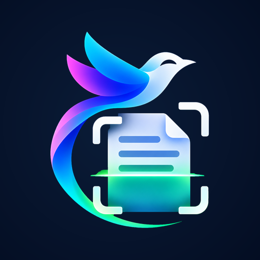

<!-- PROJECT LOGO -->
 

  

  <h3 align="center">Scanlark</h3>

  

    A Flutter app that turns images into editable text with on-device OCR.
     
    <a href="https://github.com/krishujeniya/Scanlark"><strong>Explore the docs »</strong></a>
     
     
    <a href="https://krishujeniya.github.io/Scanlark/">Production Site</a>
    ·
    <a href="https://github.com/krishujeniya/Scanlark/actions">Download CI Build</a>
    ·
    <a href="https://github.com/krishujeniya/Scanlark/issues">Report Bug</a>
    ·
    <a href="https://github.com/krishujeniya/Scanlark/issues">Request Feature</a>
  

<!-- TABLE OF CONTENTS -->

  
Table of Contents

  <ol>
    <li>
      <a href="#about-the-project">About The Project</a>
      <ul>
        <li><a href="#key-features">Key Features</a></li>
      </ul>
    </li>
    <li>
      <a href="#built-with">Built With</a>
    </li>
    <li>
      <a href="#ci-builds-and-checks">CI builds and checks</a>
    </li>
    <li><a href="#production-site">Production site</a></li>
    <li><a href="#firebase-setup">Firebase setup</a></li>
    <li><a href="#usage">Usage</a></li>
    <li><a href="#license">License</a></li>
    <li><a href="#acknowledgments">Acknowledgments</a></li>
  </ol>

<!-- ABOUT THE PROJECT -->
## About The Project

Scanlark is an OCR application built with Flutter. It extracts text from images and lets users edit, copy, and share the results.

### Key Features

- **Image to Text Conversion**
- **Support for Multiple Languages**
- **Text Editing and Copying**
- **History of Scanned Texts**
- **Share Extracted Text**

## Built With

- 
- 

<!-- CI -->
## CI builds and checks

GitHub Actions is the supported place to resolve dependencies, analyze, test,
and build this project. Pull requests and pushes to `main` run the Flutter
workflow. It enforces `pubspec.lock`; after analysis, tests, and the APK build
pass on `main`, it publishes a versioned [GitHub Release](https://github.com/krishujeniya/Scanlark/releases/latest)
with the Android APK. The workflow artifact remains available for 14 days.
Start a run from the repository's **Actions** tab to request a manual build.

The repository uses a single `main` branch. Dependency and workflow updates
must be reviewed and committed directly to `main`; automated update pull
requests are disabled so they cannot create additional branches.

## Production site

[Scanlark on GitHub Pages](https://krishujeniya.github.io/Scanlark/) is published
from the `main` branch root. Changes pushed to `main` trigger the Pages
deployment. The site introduces the app; OCR runs in the Flutter application.

## Firebase setup

The Flutter app uses Firebase project `scanlark-ocr-krishujeniya` for Android,
iOS, macOS, and web. Email/password sign-in is enabled. Cloud Firestore stores
each signed-in user's scan history in `users/{email}/history`; [firestore.rules](firestore.rules)
restricts history reads and creates to that user.

<!-- USAGE -->
## Usage

1. Download the APK from [the latest GitHub Release](https://github.com/krishujeniya/Scanlark/releases/latest) and install it on an Android device.
2. Sign in or create an account with email and password.
3. Capture a new image or choose one from the gallery. Review the recognized text, then copy, share, or create a QR code from it.
4. Revisit saved scans from History. Records are stored in the signed-in user's Firestore history.

This is a GitHub Release APK, not a Play Store release.

<!-- LICENSE -->
## License

Distributed under the MIT License. See `LICENSE.txt` for more information.

<!-- ACKNOWLEDGMENTS -->
## Acknowledgments

- [Dart](https://dart.dev/)
- [Flutter](https://flutter.dev/)
- [Open Source Community](https://opensource.org/)
- [Contributors](https://github.com/krishujeniya/Scanlark/graphs/contributors)
